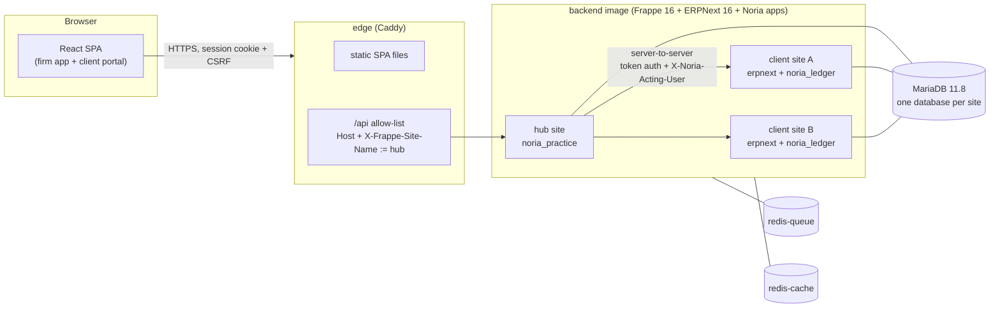
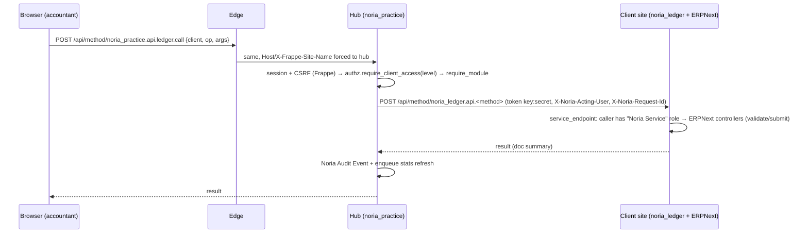
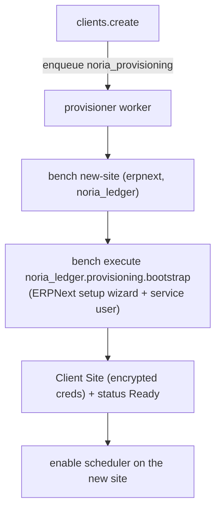

# Noria Ledger — Architecture

## 1. Layers

| Layer | Implementation | Responsibility |
|---|---|---|
| A — Frontend | `frontend/` React + TS + Vite + TanStack (Router, Query, Table, Form) + Tailwind + Radix + Zod | Everything users see. Talks only to `/api/method/noria_practice.*` (+ Frappe login/logout). |
| B — Practice hub | `apps/noria_practice` on the **hub site** | Firms, members, clients, engagements, assignments, entitlements, provisioning, tasks, monthly reports, documents metadata, portal, messages, audit, broker. |
| C — Accounting engine | ERPNext 16 + `apps/noria_ledger` on **each client site** | Authoritative books. `noria_ledger` is a thin service API over ERPNext controllers and reports; it never writes ledger tables. |

## 2. Tenancy model

* **Accounting Firm** and **Client Business** are separate records. A client is served by firms through
  **Client Engagements** (many-to-many, explicit, audited); firm staff reach a client through their firm's active
  engagement plus either the Firm Admin role or a **Client Assignment** (Lead Accountant / Accountant / Reviewer /
  Read Only).
* Each Client Business gets its **own Frappe site and database** (`<slug>-<client-id>.ledger.internal`), created by
  the provisioner from ERPNext's setup wizard: company, chart of accounts template, fiscal year, country tax templates.
  Independent backups/restores per client are therefore native (`bench --site <client> backup`).
* All sites share one image, one gunicorn pool, one set of workers, one Redis pair and one MariaDB server.
* Client documents are stored as **private files on the client's own site**; the hub stores only metadata.

## 3. Request flow (hub-brokered access)

* `ledger.OPERATIONS` is the complete allow-list of accounting operations, each with a minimum access level and
  a required module. Reversal/cancellation of posted vouchers requires Lead level.
* The client site records the acting user on documents (`noria_acting_user` custom field) and in its own
  `Noria Activity Log` (also the idempotency store, unique `idempotency_key`).
* Errors from client sites are reduced to their user-facing message; tracebacks never reach the browser.

## 4. Security boundaries

| Boundary | Control |
|---|---|
| Internet → client sites | Not routable: the edge forwards only allow-listed paths and **overwrites** `Host`/`X-Frappe-Site-Name` to the hub. Verified by tests (spoofed header → 404). |
| Browser → hub data | Hub DocTypes grant permissions only to System Manager, so `/api/resource` is useless to users (and blocked at the edge). Product APIs authorize in `noria_practice/authz.py`. |
| Hub → client site | Per-site API key/secret of a dedicated service user (stored encrypted in `Client Site`, Password field). The service user holds ERPNext accounting roles, the "Noria Accounting" module profile, and no System Manager role. |
| Firm ↔ firm, client ↔ client | `authz.require_client_access` everywhere; no existence oracle (same error for "not found" and "denied"). Covered by hub tests and the E2E isolation step. |
| Client portal users | Website Users with role `Noria Client User`; portal endpoints only; see only *published* reports of their own client. Firm staff cannot be portal users. |
| DB root credentials | Docker secret mounted only into `db` and the `provisioner` worker (dedicated `noria_provisioning` queue). |
| Entitlements | `authz.require_module` / `require_firm_module` on the server for every operation; the UI merely reflects them. |

Hiding ERPNext workspaces on client sites (`noria_ledger/install.py`) is presentation for operators using the desk;
it is **not** a security control.

## 5. Provisioning

Every step is idempotent; failures set `provisioning_status = Failed` with a redacted error and can be retried
from the UI. Measured duration: ~130 s per client on the reference machine (see the optimization report).

## 6. Workflows

* **Bookkeeping:** draft → posted (ERPNext submit) → reversed (new reversing entry) or cancelled (ERPNext cancel).
  Idempotency keys on all creating operations.
* **Banking:** pluggable statement parsers (`noria_ledger/importers`: generic CSV, M-PESA CSV) → ERPNext Bank
  Transactions with a unique fingerprint (duplicate detection) → ERPNext matching/reconciliation, or
  "categorise" (bank journal entry + reconcile).
* **Monthly report:** prepare (snapshot of ERPNext TB/P&L/BS, refused if the TB does not balance) → In Review →
  Approved (reviewer ≠ preparer, except for independent accountants) → Published (client portal) → client approval.
* **Practice:** recurring tasks from templates (monthly/quarterly/annual, fiscal-year aware, module-aware), assignee
  → reviewer flow, workload view; document requests ↔ uploads ↔ review; messages.

## 7. Data that must not be lost

| Data | Where | Backed up by |
|---|---|---|
| Client books + client documents | client site DB + `sites/<client>/private/files` | per-site encrypted backup |
| Practice data, users, client-site credentials | hub DB | hub encrypted backup |
| Site configs incl. DB passwords and `backup_encryption_key` | `sites/*/site_config.json` | **must be stored separately in a secret manager** |
| Job queue | redis-queue AOF | volume snapshot (jobs are re-creatable) |

## 8. Extension points

* **AI assistance (future):** suggestions must call the same `ledger` operations with a human approving them;
  postings stay deterministic. A suggestion store would live on the hub; no client data leaves the platform without
  explicit consent/contracts (module `ai_assistance` is defined but has no implementation).
* **New bank formats:** add a parser class to `noria_ledger/importers` and register it.
* **eTIMS / payments:** to be added as separate integration modules once official specifications and credentials
  are available (see [KENYA_COMPLIANCE.md](KENYA_COMPLIANCE.md)).
